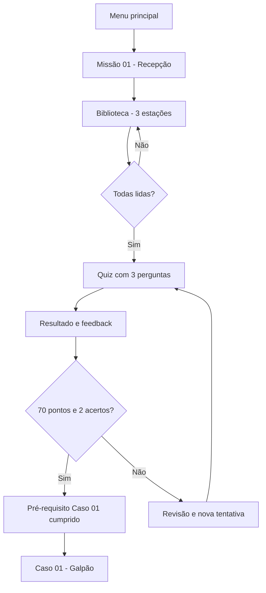

# Sessão 21 — Missão 01: Conhecendo a NR-1 no Brasil (Alpha 1.2)

Data: 13/10/2026.

## Objetivo

Adicionar uma entrada pedagógica jogável ao PilhA+ Game antes do Caso 01, com um mentor, uma biblioteca interativa, glossário e três verificações de compreensão. Público misto (trabalhadores, gestores, RH/SST, profissionais de apoio). O jogo é mobile-first e jogável também no navegador desktop.

## Conteúdo e consistência normativa

**Fontes oficiais:**

- [NR-1 — texto vigente e publicações](https://www.gov.br/trabalho-e-emprego/pt-br/acesso-a-informacao/participacao-social/conselhos-e-orgaos-colegiados/comissao-tripartite-partitaria-permanente/normas-regulamentadora/normas-regulamentadoras-vigentes/nr-1)
- [Manual GRO/PGR 2026](https://www.gov.br/trabalho-e-emprego/pt-br/assuntos/inspecao-do-trabalho/manuais-e-publicacoes/2026/manual_gro_pgr_da_nr_1.pdf)
- [Guia de fatores de riscos psicossociais relacionados ao trabalho (MTE, 2025)](https://www.gov.br/trabalho-e-emprego/pt-br/acesso-a-informacao/participacao-social/conselhos-e-orgaos-colegiados/comissao-tripartite-partitaria-permanente/normas-regulamentadora/normas-regulamentadoras-vigentes/guia-nr-01-revisado.pdf)

A nova redação do capítulo 1.5 da NR-1, em vigor desde 26 de maio de 2026, incluiu expressamente os fatores de risco psicossociais relacionados ao trabalho no Gerenciamento de Riscos Ocupacionais (GRO). A missão respeita o recorte de fatores *relacionados ao trabalho*, sem tentar diagnosticar pessoas.

**Glossário:** saúde mental, fatores de risco psicossociais, segurança psicológica, GRO, trabalho prescrito x real, psicologia e psiquiatria.

## Fluxo e estados

**Regras de pontuação aprovadas:** 20 pontos por estação concluída (60), 10 por resposta correta (30) e 10 por conclusão (10), total 100. Pré-requisito: **nota >=70 e pelo menos 2/3 acertos**, além da leitura dos três conceitos. Esse segundo critério impede que alguém avance acertando 0/3 apenas por ter clicado nos cartões. Sem penalização por tentativas.

Um usuário com progresso pré-existente no Caso 01 continua seu jogo sem ser redirecionado para o tutorial. Progresso legado preservado. Novos jogadores encontram Missão 01 na navegação e antes do Galpão.

## Arte, sala e personagens

- Biblioteca atual: SVG isométrico original e modular, com três hotspots HTML acessíveis por mouse, toque e teclado; **não é uma cena 3D final**.
- Mentor: avatar ilustrativo temporário (paletó amarelo-mostarda); Meshy deve gerar personagem independente com rigging próprio.
- Cena GLB: o laboratório 3D agora oferece importação local de galpão `.glb` com normalização de escala e cache IndexedDB. **A FBX original não foi convertida por este ciclo**. Interações e colisões finas com o novo modelo ainda demandam medição e ajuste.
- O conteúdo da missão está em `content/mission01.json`; elementos podem ser ajustados sem alterar toda a lógica.

## Arquivos da etapa

| Caminho | Descrição |
|---|---|
| `missao01.html`, `mission01.css`, `mission01.js` | Interface interativa de biblioteca, estado, quiz e pontuação |
| `content/mission01.json` | Conceitos, exemplos, perguntas, respostas e fontes |
| `assets/v12/biblioteca-isometrica.svg` | Cenário isométrico provisório (arte vetorial) |
| `intro-gate.js` | Pré-requisito de novos jogadores para o Caso 01 |
| `app.js`, `app.css`, `caso01.html`, `case01.js` | Links, glossário, menu, continuidade e proteção de progresso |
| `scene3d.html` | Importador GLB local de galpão, preservando interface anterior |
| `prompts/MESHY-MISSAO-01-ASSETS.md` | Prompts e lista detalhada de assets Meshy |
| `tests/mission01.test.mjs` | Testes de progressão e regressão |

## Cronograma — 1 hora diária (próximo ciclo)

| Sessão (1h) | Trabalho | Entregável |
|---|---|---|
| 22 | Validar missão no celular e desktop | Capturas, correções UX |
| 23 | Gerar mentor em Meshy, conferir proporções | Modelo estático aprovado |
| 24 | Fazer rigging e 3 clipes principais | GLB + idle/talk/point |
| 25 | Gerar biblioteca modular sem personagens | GLB do ambiente |
| 26 | Criar estante, terminal e mesa isolados | 3 props otimizados |
| 27 | Posicionar transformações/hotspots e colisões | Estações 3D navegáveis |
| 28 | Converter e otimizar o galpão existente | GLB leve testado |
| 29 | Substituir geometria de teste, testar interação | Galpão com assets oficiais |
| 30 | QA cruzado de Missão 01 → Caso 01 | Fluxo de ponta a ponta |

## Critérios de aceite

1. 3 conceitos consultáveis + respostas contextualizadas.
2. Quiz com 3 perguntas, feedback e reentrada em falhas.
3. Score e condição de avanço persistidos em `localStorage['pilha-missao01-v1']`.
4. Novo jogador sem pré-requisito inicia a missão; caso aberto diretamente redireciona para Missão 01.
5. Progresso pré-existente do Caso 01 não é apagado nem bloqueado.
6. Biblioteca (glossário geral) atualizada com os conceitos e fontes oficiais.
7. Opção para importar galpão 3D do Meshy de forma **local**, sem upload, mantendo o fallback.
8. Testes de lógica e de UI automatizados; revisão visual humana ainda necessária para considerar QA concluída.

**Limite ético e legal:** não usar a pontuação para avaliação de saúde mental individual, remuneração ou avaliação de funcionários; pontuação é resultado pedagógico fictício, não diagnóstico ou adequação regulamentar.
