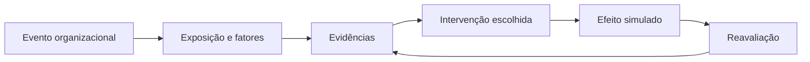

# Motor de simulação — hipótese de design
O motor deve modelar **fatores organizacionais**, não diagnósticos ou predições clínicas.

## Caso-exemplo
Metas incompatíveis com capacidade → horas extras → fadiga e conflitos → sinais coletivos de desgaste. Redistribuir tarefas e revisar metas atua no fator organizacional, com acompanhamento. Palestra ou meditação podem complementar, mas não substituem medidas estruturais.
## Regras
- Evidências liberadas por trabalhador, liderança, documentos e indicadores.
- Indicadores podem ter incerteza, atrasos e informações conflitantes.
- Não atribuir causalidade clínica automática a uma variável.
- Impactos são ficcionais, calibrados para aprendizagem, não probabilidades reais.
- Medidas exigem tempo, investimento e participação; a escolha deve produzir feedback explicado.
