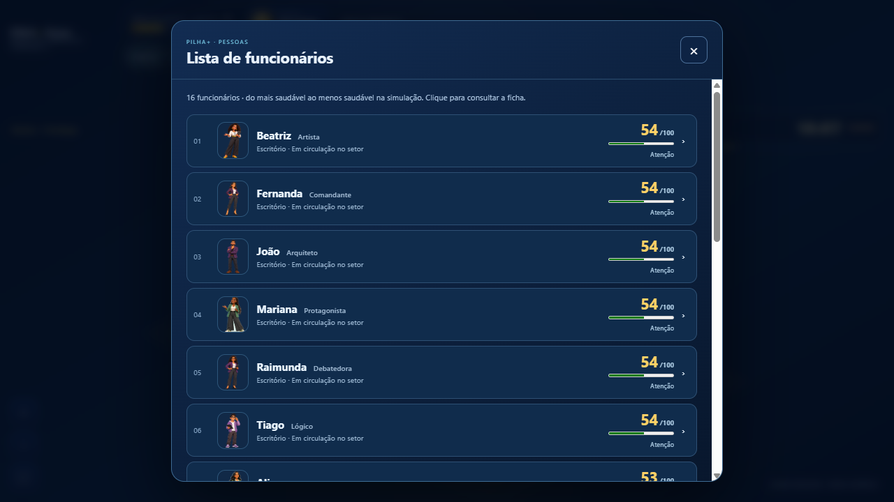
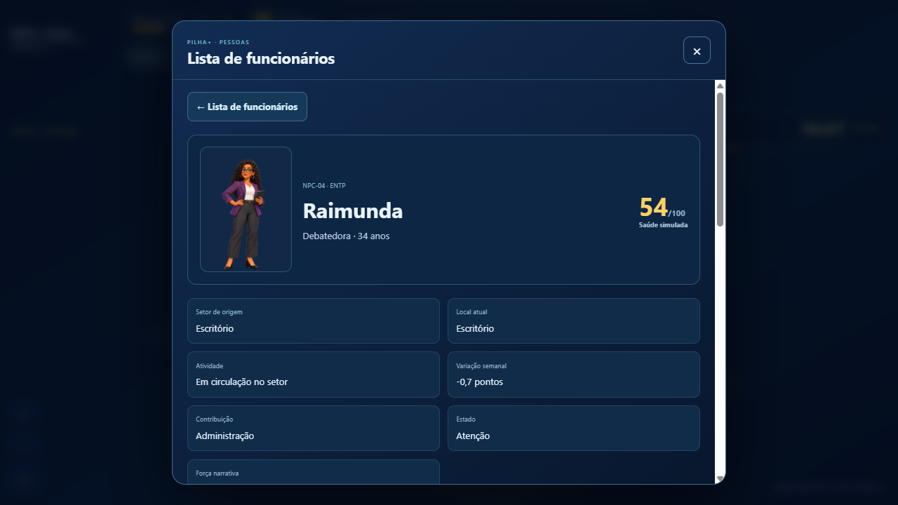
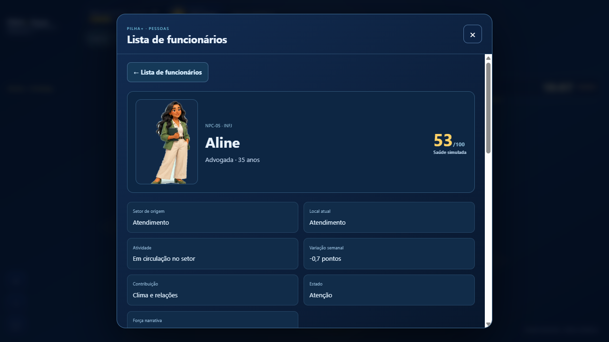
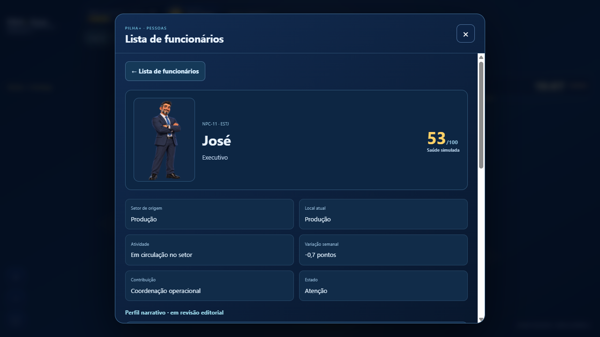
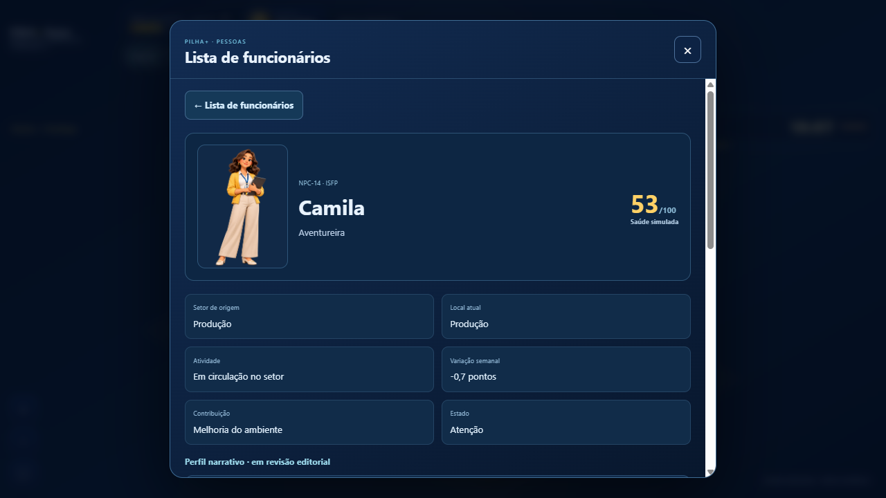
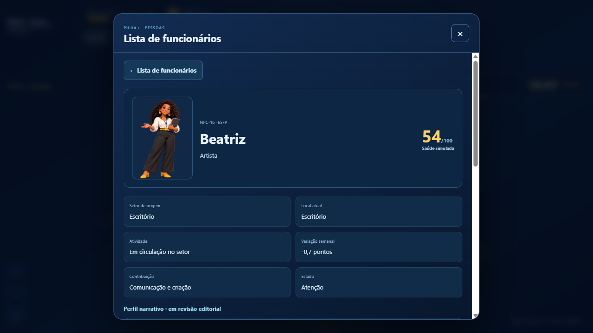
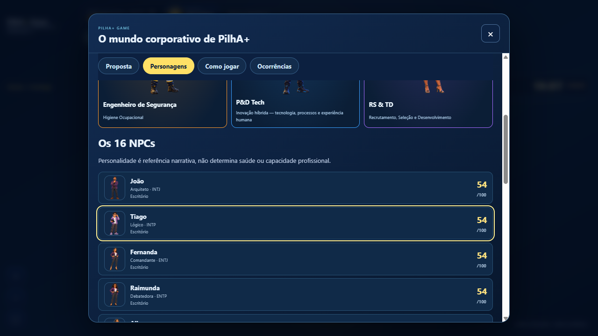
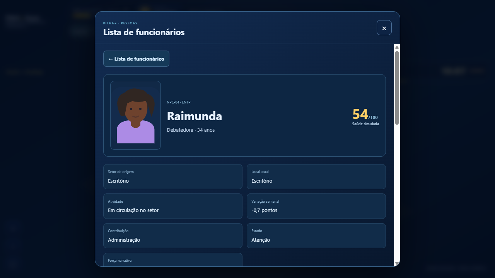
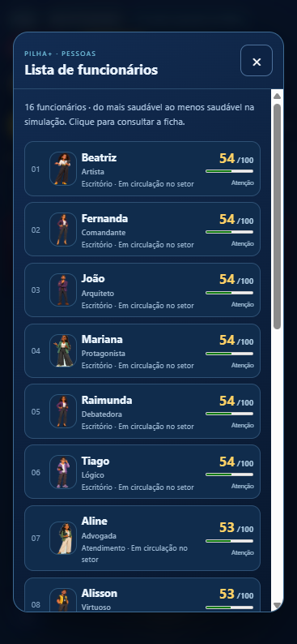
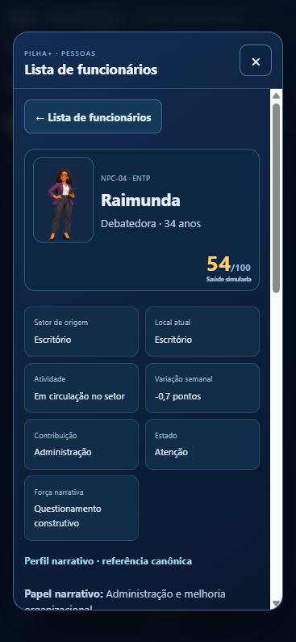

# Fase 1 — identidades e fichas dos 16 NPCs

Base: `fix/npc-focus-codex-continuation`, commit `70c64280e9bee29fa070fc2d9a938b302e237003` (PR #40). Entrega: `codex/npcs-fase1-perfis`.

## Fontes e integridade

- Especificação do PM preservada em [NPCS-FASE1-2026-10-23.md](../../specs/NPCS-FASE1-2026-10-23.md).
- Catálogo importado sem alteração do commit `3921a7bc81f5ad59b584df7b3c0a97e9d7a493ae`, branch `feat/npc-balanceamento-contextual`.
- ZIP aprovado SHA256: `e63e8d1494e8cdfd4fbcd9b6dcdf752d4c7934c21c7bdce37a442305409f20db`.
- NPC-01–04: recortes existentes aprovados, reaproveitados por ID. NPC-05–16: PNGs transparentes do pacote, sem troca de pessoas ou novas gerações.
- [art-integrity.json](art-integrity.json) registra dimensões, bytes, SHA256 e transparência dos 16 arquivos. Total: 14.946.924 bytes, com carregamento lazy.

## Implementação e critérios

Os 16 registros mantêm seus IDs, setores, cores e valores da simulação. O gerador produz perfis narrativos a partir do catálogo canônico. Lista, ficha e catálogo compartilham o mesmo retrato por ID. Oito perfis detalhados exibem forças, pontos de atenção, condições favoráveis, contextos de risco e sinergias propostas. NPC-09–16 continuam em revisão editorial, sem idades inventadas. Metadados de efeitos propostos não são executados.

A falha de imagem mostra o SVG anterior da mesma pessoa; uma tentativa automática limitada recupera falhas transitórias. O carregamento posterior restaura a arte. Todo texto narrativo recebe escape HTML. A ficha recebe foco no título e retorna o foco ao funcionário ao voltar.

Motor, saúde, calendário, movimento, câmera/foco da PR #40, mapa, três sprites existentes, dupla, economia e persistência permanecem byte a byte iguais à base. Nenhuma migração de save.

## Validação

- `npm test`: regressão do projeto, incluindo os oito testes novos de perfis.
- `npm run test:continuous`: 17 testes aprovados.
- `npm run test:living`: 16 testes aprovados, incluindo foco durante trabalho/pausa.
- `npm run test:npcs`: geração idempotente + oito testes de identidade, narrativa, integridade, saúde preservada, fallback e CSS responsivo.
- `npm run build`, `git diff --check`, verificação sintática JS/Python aprovados.
- QA local no navegador: desktop 1361×765 e celular 390×844; 16 retratos carregados, sem overflow horizontal; corpo inteiro com `contain`; Camila e Beatriz distintas; Letícia NPC separada da mentora da biblioteca; fallback 404 da Raimunda recuperado sem mudar saúde/orçamento; Localizar centraliza a pessoa; retorno de foco confirmado no celular.
- GitHub Actions executa o navegador também em 1366×900 e 390×844, cobrindo todos os 16 perfis, movimento/pausa, localização, calendário, leitura do catálogo e persistência. Consultar resultado na PR antes da aprovação.

## Evidências locais

## Limites e decisões pendentes

A Fase 1 não individualiza sprites no mapa nem ativa efeitos contextuais de personalidade. Os oito perfis pendentes exigem definição editorial pelo PO/PM. As artes somam cerca de 15 MB; uma futura otimização deve preservar as fontes aprovadas e a integridade por ID. Validação móvel em viewport Chromium, sem homologação em aparelhos físicos/Safari ou leitor de tela. PR para aprovação, sem merge e sem atualização do alias público de produção.
