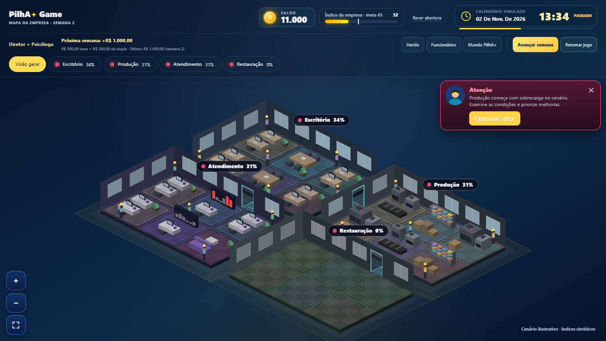
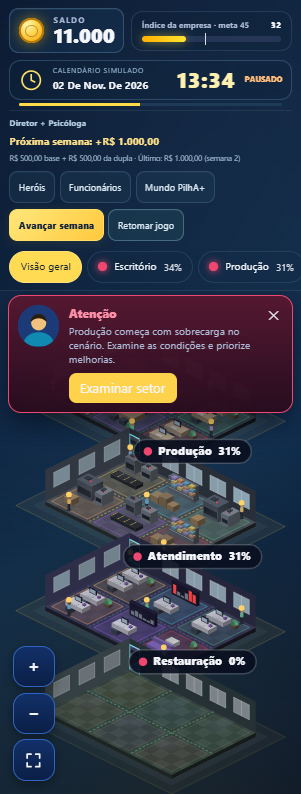
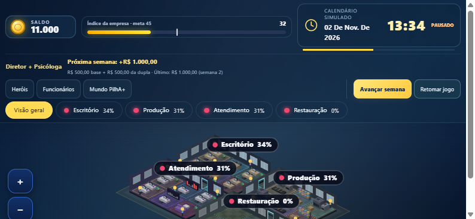

# Cabeçalho translúcido e revisão final — 24/10/2026

Pedido posterior do PM: transparência na barra superior e melhor organização dos elementos. Continuação da PR #41, após revisão do backlog e correção landscape no commit `4b59caf`.

## Entrega

Barra com gradiente semitransparente (alfa36% a62%), blur de fundo e borda discreta. Cards e botões também usam fundos translúcidos com texto de alto contraste. Fallback de fundo mais opaco quando o navegador não suporta blur.

Três faixas: marca/saldo/índice/calendário; dupla/receita e grupos Explorar empresa/Controlar tempo; navegação de setores. Botões de funcionários e mundo têm rótulos visuais menores, preservando nomes acessíveis completos. Avançar semana mantém destaque amarelo; pausa e alerta mantêm estados reconhecíveis.

Os elementos DOM existentes são movidos, preservando listeners de abas, replay, eventos e calendário. Não muda orçamento, saúde, relógio, seleção ou persistência. Mapa ajusta sua área à altura real da barra; landscape reserva240px e permite acesso vertical ao conjunto.

## Verificação

Build, sintaxe JS/Python e nove testes de perfis passaram localmente. Inspeção no navegador em1361×765,320×844 e844×390: barra única, sem overflow horizontal, calendário continua abrindo e mapa utilizável. Em320px, mapa medido em535px; em landscape,240px na nova estrutura. Transparência confirmada no estilo computado. A validação ampliada encontrou overflow do relógio em320px; o calendário móvel passa a usar grade com data flexível e hora/estado na terceira coluna, mantendo todo o conteúdo.

O QA GitHub repete os26 testes de empresa viva,17 de modo contínuo,9 de perfis, npm test e cinco resoluções (1366×900,390×844,320×844,844×390,1440×900), incluindo teclado, toque simulado, duas abas, receita, gestão, localização e reload. Consultar resultado final na PR; não confundir cobertura configurada com teste concluído.

Backlog e limites remanescentes estão em [ESTADO-TESTES-2026-10-24.md](../backlog/ESTADO-TESTES-2026-10-24.md): aparelho físico/Safari, leitor de tela, contraste formal, zoom real200%, sessão humana longa e funcionalidades de branches futuras. Sem merge ou produção.
