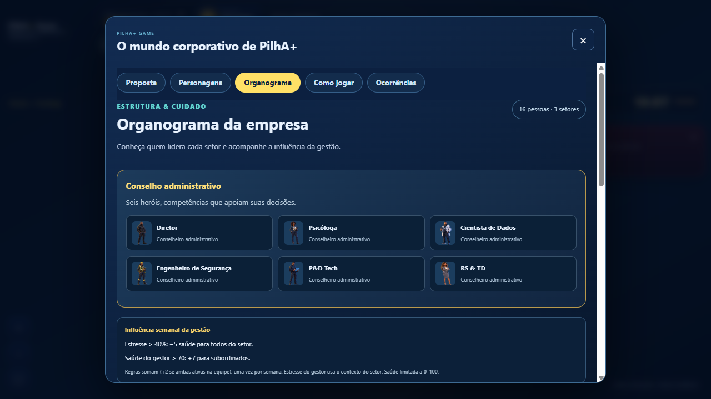
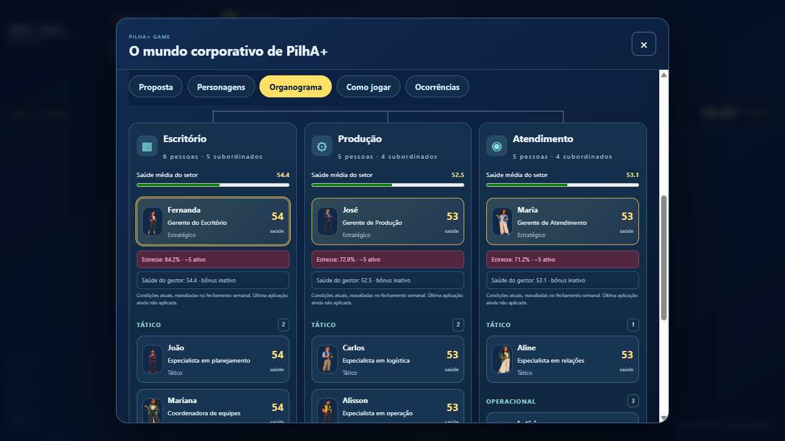

# Gestão: saúde da equipe e organograma

Pedido do PM: duas regras funcionais de gestão e melhoria visual do organograma. Continuação da PR #41 sobre `119abfe`, branch `codex/npcs-fase1-perfis`.

## Regras executáveis

| Condição estrita | Quem recebe | Efeito semanal |
|---|---|---|
| Estresse do gestor >40% | Todos os funcionários do setor, incluindo o gestor | −5 saúde |
| Saúde geral do gestor >70 | Subordinados do mesmo setor, excluindo o gestor | +7 saúde |

Os dois efeitos somam: quando ambos estão ativos, subordinados recebem +2 e o gestor −5. Valores exatamente 40 e 70 não ativam a respectiva regra. Saúde limitada a 0–100. Sem efeitos por quadro, consulta, mudança de câmera ou recarga.

O jogo só possui estresse contextual por setor. O gestor usa esse indicador existente (`metrics.stress`, derivado de carga, autonomia e liderança), identificado na interface como contexto do setor. Não foi inventada medição individual ou clínica. O critério de saúde usa o valor interno, sem arredondar a borda do limiar.

Em cada semana: primeiro atualiza saúde por ambiente/restauração; depois captura todas as condições gerenciais e aplica os dois efeitos simultaneamente. A perda do gestor nessa etapa não muda retroativamente o bônus dos subordinados no mesmo ciclo. Todos são avaliados por setor de origem, inclusive em pausa restaurativa.

Cada funcionário persiste o último registro de influência: semana, gestor, saúde/estresse observados, perda, bônus e saldo efetivamente aplicado após limites. Validação rejeita registros inválidos. Saves antigos entram sem perda retroativa e continuam a partir do próximo fechamento. Pausa, pendência de decisão, orçamento, instalações, câmera e regras de tempo preservadas.

## Dados do ambiente e feedback

A saúde dos personagens é alterada no estado salvo, afetando score, ordenação, classificação, variação semanal e aparência dos indicadores já derivados desse score. A saúde média real de cada setor é exibida no organograma e acompanha esses dados. Não são adicionados valores arbitrários aos seis fatores psicossociais ou ao índice econômico da empresa.

Organograma com conselho ilustrado, conexão visual, retratos por ID, destaque das gerências, scores, médias com barras, alertas de −5/+7 e semana da última aplicação. Mostra condições atuais, reavaliadas no próximo fechamento. Fichas exibem contexto de estresse e o saldo aplicado. O organograma aberto acompanha mudanças de dados sem gastar recursos; rolagem e foco são preservados.

## Verificação

- 21 testes de empresa viva: condições exatamente e acima dos limiares, efeito combinado, abrangência por setor, autoexclusão do bônus, limites, snapshot, média, persistência, saves antigos, pausa, leituras sem efeito e reconciliação independente da divisão dos ticks.
- Nove testes de perfis e organização aprovados, preservando os 16 IDs e artes.
- Build e verificação sintática aprovados; QA GitHub ampliado com regras visíveis, três médias e último ciclo aplicado aos 16 funcionários.
- Prova manual no navegador local (save sintético): da semana 8 à 9, NPC-01 passou de 54,38595424 a 48,863763392; registro gerencial −5, além da atualização ambiental normal. Saldo permaneceu 10.000. Média do Escritório exibida em 48,9.
- Celular 390×844 sem overflow horizontal, cartões e efeitos legíveis. Evidências abaixo. Resultados completos do commit estão na PR.

Limites: estresse gerencial compartilha o indicador do setor; sem diagnóstico ou promessa de efeito real. Não há bônus financeiro, edição de cargos ou novos trajetos nesta entrega. Teste móvel em Chromium, sem aparelho físico/Safari. Sem merge ou atualização de produção.
