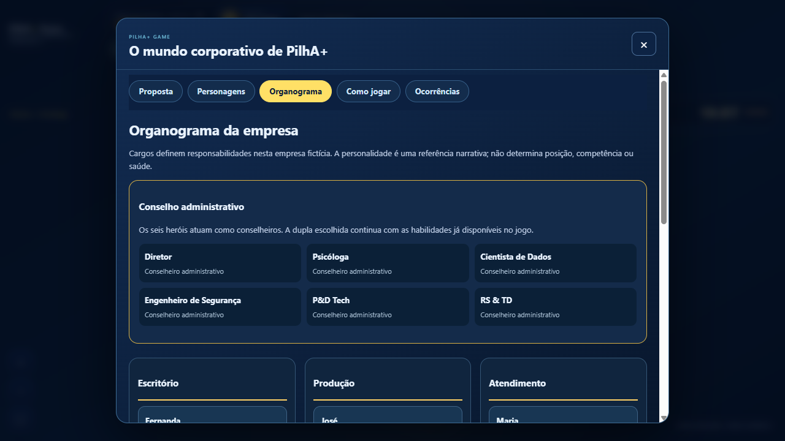
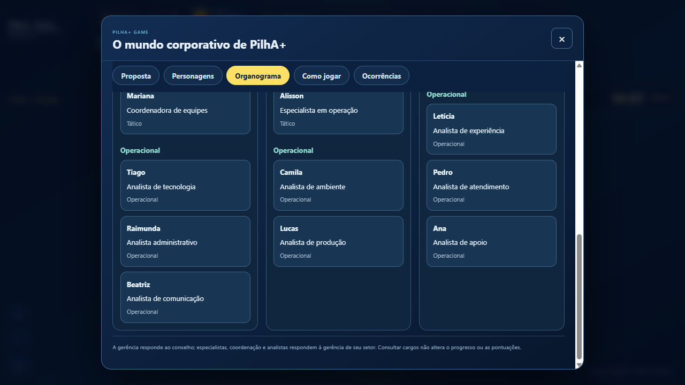
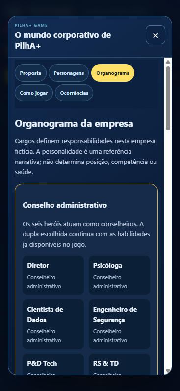
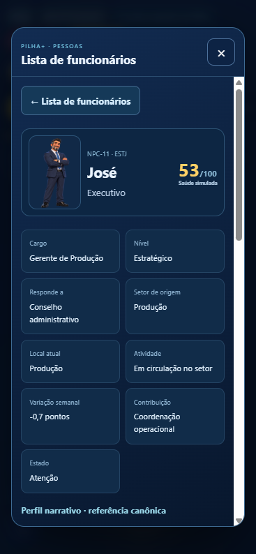

# Narrativa completa e hierarquia dos NPCs

Continuação da PR #41, autorizada pelo PM: definir os oito perfis autonomamente, considerar o tipo de personalidade e revisar a implementação da hierarquia. Base da continuação: `e05679b` em `codex/npcs-fase1-perfis`.

## Achados e entrega

A branch remota não tinha cargos estruturados ou organograma. A atribuição já existia no checkpoint local `05af128` (`codex/npcs-patio-rotinas`), fora da PR. Foi recuperada somente a organização, preservando o motor e a circulação da base.

Os oito perfis do catálogo v1.1 agora têm narrativa, forças, pontos de atenção, condições favoráveis/adversas e sinergias narrativas. Idades continuam null; ambientes experimentais e pontos desses oito continuam null. Preferências são tendências de personagens fictícios, nunca inferência de doença ou aptidão. Não há bônus automático por MBTI, sinergia ou cargo.

- Carlos: organização, consistência e logística.
- Ana: apoio, continuidade e cuidado nos combinados.
- José: objetivos, responsabilidades e acompanhamento.
- Maria: vínculos, comunicação e acordos.
- Alisson: investigação prática e soluções concretas.
- Camila: experiência cotidiana e melhoria dos espaços.
- Lucas: resposta a imprevistos e alternativas práticas.
- Beatriz: expressão, criação e comunicação colaborativa.

## Estrutura implementada

Heróis: seis conselheiros administrativos, sem transformar herói em trabalhador do mapa. A escolha da dupla mantém as regras atuais.

| Setor | Gerência estratégica | Camada tática | Camada operacional |
|---|---|---|---|
| Escritório | Fernanda | João e Mariana | Tiago, Raimunda e Beatriz |
| Produção | José | Carlos e Alisson | Camila e Lucas |
| Atendimento | Maria | Aline | Letícia, Pedro e Ana |

As três gerências respondem ao conselho. Os demais funcionários respondem à gerência do setor, com especialistas/coordenação no nível tático e analistas no operacional. Essa estrutura é estática e explícita, não calculada por personalidade ou saúde. Cargos, nível e vínculo aparecem na ficha; cargos também aparecem na lista e catálogo. A aba Organograma liga cada registro à sua ficha.

## Verificação e evidências

Nove testes de perfis/organização, incluindo gerência única por setor, 16 vínculos únicos, seis conselheiros separados, ausência de alteração em estado/saldo e conservação das artes. QA automatizado desktop/mobile ampliado para verificar o organograma e a ficha de José. Ver resultado final do GitHub Actions na PR.

QA local no navegador: organograma com 16 funcionários, 3 gerentes e 6 conselheiros; viewport móvel 390×844 sem overflow; vínculo abre a ficha com cargo, nível e conselho. Desktop em três colunas; celular empilha os departamentos. Capturas:

Limites: sem edição de cargos pelo jogador, remuneração, contratação ou comportamento autônomo de chefia. Postos físicos e trajetos não foram alterados. Sprites individuais e rotina diária de pátio permanecem em outra entrega. Não houve merge ou atualização de produção; a prévia automática da PR é o alvo de revisão.
