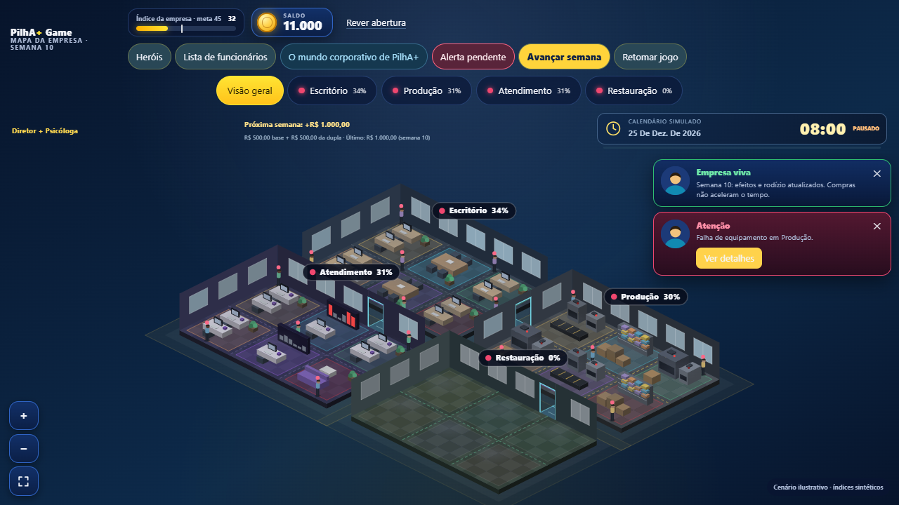
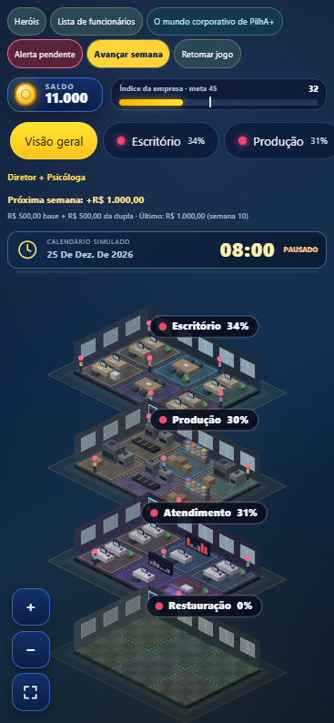

# Receita semanal para investimento

Pedido do PM: R$ 500,00 por semana nova, com adicional de R$ 250,00 por herói épico selecionado. Continuação da PR #41, base `f127d10`, branch `codex/npcs-fase1-perfis`.

## Comportamento

- Base R$ 500 por semana simulada nova, no orçamento compartilhado de melhorias.
- Principal e apoio contam uma vez cada, somente com dupla válida salva e raridade Épico no `hero-roster.js`.
- Dois épicos: R$ 1.000. Épico + P&D Tech (Lendário): R$ 750. Sem dupla válida: apenas R$ 500. Não há bônus por herói apenas consultado na galeria.
- Seleção é lida no fechamento da semana. Trocar a dupla não credita novamente a semana atual. Compras e consultas não geram receita.
- Registro persistido contém última semana paga, total recebido e composição do último crédito (base, bônus, IDs épicos, valor nominal e efetivo).
- Saves existentes são inicializados na semana atual, sem zerar saldo/compras ou pagar semanas anteriores à instalação. Começam a receber na próxima semana.
- Reconciliação de semanas pendentes paga cada semana percorrida uma vez, usando a dupla salva. Tempo pausado não gera semanas nem créditos. O avanço manual existente também cria uma semana nova e paga a receita.
- Limite técnico existente do orçamento (R$ 1 bilhão) preservado; se houver pouco espaço até esse limite, o crédito efetivo é reduzido e registrado. Não há dinheiro real.

## Interface

HUD mostra receita prevista da próxima semana, base, bônus da dupla e último recebimento. Explicação inicial e guia Como jogar apresentam a regra. Formatação monetária brasileira. Saúde, regras gerenciais, câmera, NPCs e preços permanecem como na base.

## Verificação

26 testes de empresa viva aprovados, incluindo cálculo por raridade, lendário sem bônus épico, dupla inválida/duplicada, crédito utilizável em compras, troca de dupla, recarga, pausa, reconciliação, saves antigos, limite do saldo, corrupção de registro e gravação atômica com falha/duas abas. Build e verificação sintática aprovados.

QA local em save sintético: semana9→10, Diretor + Psicóloga, saldo10.000→11.000; base500 + bônus500, total recebido1.000, IDs dos dois épicos registrados. Celular390×844 sem overflow. QA GitHub ampliado com verificação de depósito e HUD; resultado final na PR.

Sem merge ou atualização de produção; prévia automática da PR para revisão. Móvel validado por viewport Chromium, sem homologação em aparelho físico/Safari.
